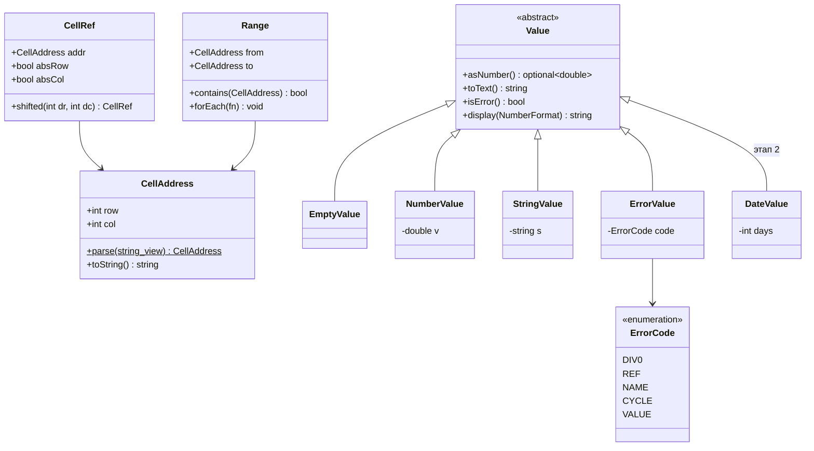
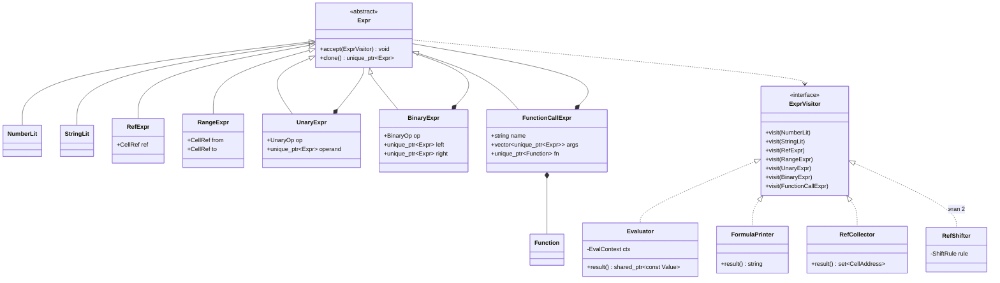
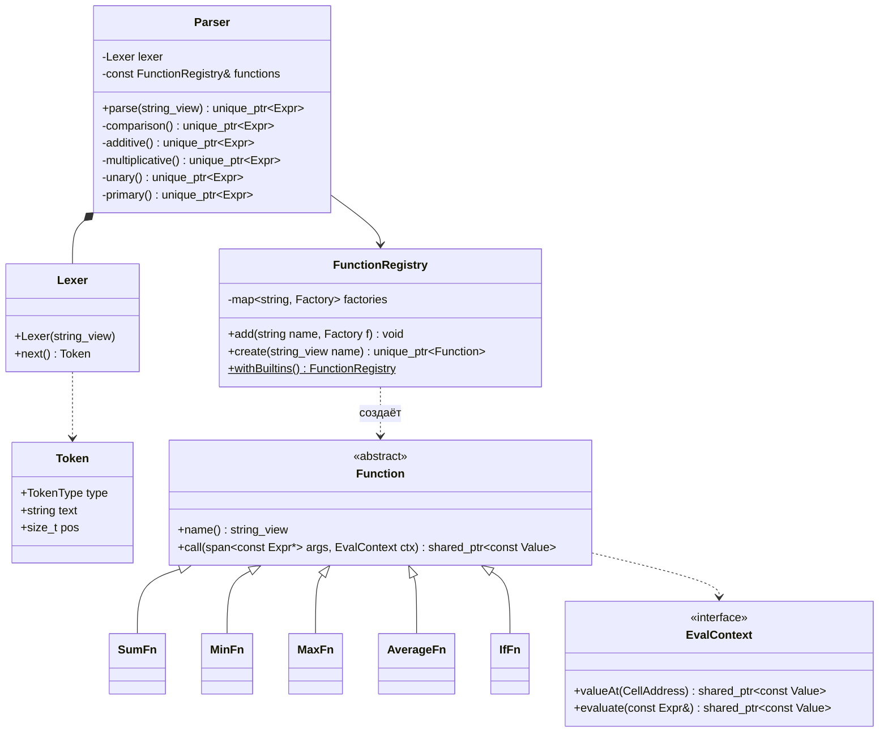
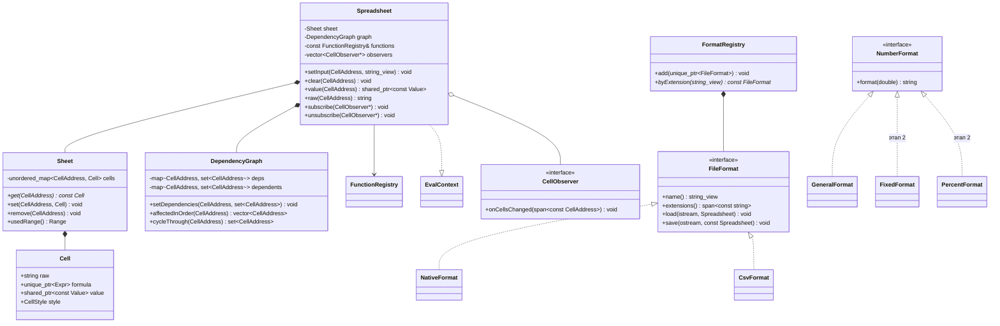
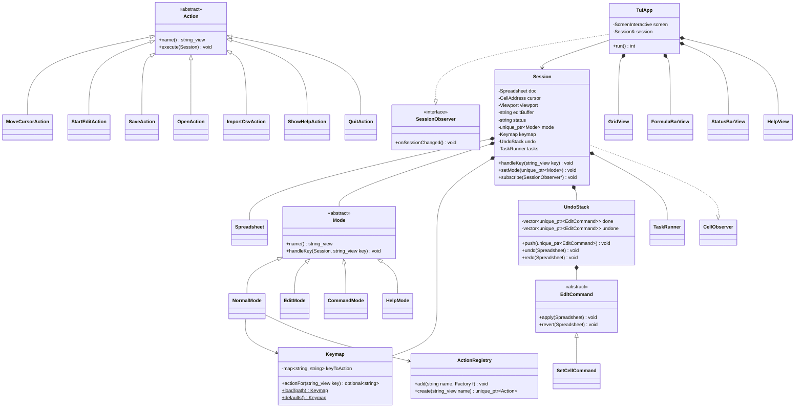

# Табличный процессор

## Диаграмма классов

Я разбил диаграмму на несколько частей, потому что одна общая получилась слишком большой.
### Адреса и значения

`CellAddress` это просто номер строки и столбца. `CellRef` это ссылка из формулы, в ней ещё есть флаги для `$`. На первом этапе они не нужны, но пригодятся при копировании.

Значения сделаны через наследование от `Value`. Так проще добавить новый тип, например дату. Ошибки вроде `#DIV/0!` тоже считаются значением, чтобы ошибка в одной ячейке не ломала остальные.

Дату буду хранить как количество дней, тогда разность дат считается обычным вычитанием.

### Формулы

Формула после разбора хранится как дерево. Например, `=A1*2+SUM(B1:B3)`: сверху плюс, слева от него умножение, справа функция.

С этим деревом надо делать несколько разных вещей: считать значение, печатать формулу обратно в текст, искать ссылки на другие ячейки. Каждое такое действие я вынес в отдельный класс-посетитель.

### Парсер и функции

Парсер пишу сам. `Lexer` делит строку на токены (числа, ссылки, знаки), а `Parser` строит из них дерево методом рекурсивного спуска. Каждый метод отвечает за свой приоритет операций: сравнения, потом `+ -`, потом `* /`, потом унарный минус.

Парсер не знает, какие функции существуют. Когда он видит имя, например `SUM`, он спрашивает у `FunctionRegistry`. Если функции с таким именем нет, получится `#NAME?`.

Аргументы функция получает ещё не посчитанными. Это нужно для `IF`: в `=IF(A1=0, 0, 1/A1)` деление не должно считаться, если A1 равно 0.

### Лист, граф зависимостей и файлы

`Sheet` хранит только заполненные ячейки, пустые не хранятся.

`DependencyGraph` помнит, какая ячейка от какой зависит. По нему видно, что надо пересчитать после изменения ячейки.

`Spreadsheet` это главный класс ядра. Всё остальное (лист, граф, парсер) используется через него.

### Приложение и интерфейс

`Session` хранит всё, что относится к текущей работе: документ, курсор, режим, сообщение в строке состояния. Нажатую клавишу она передаёт текущему режиму, потому что в разных режимах одна клавиша делает разное.

Какая клавиша что делает, написано в `Keymap`, он читается из конфига. Там клавише соответствует имя действия, а `ActionRegistry` создаёт по этому имени объект `Action`.

`UndoStack` и `EditCommand` понадобятся только на втором этапе.

## Слои и зависимости между ними

Программа состоит из трёх частей, в CMake это три цели:

- `core` — ядро: ячейки, формулы, пересчёт, сохранение и загрузка. Про терминал ничего не знает. Тесты подключаются только к нему.
- `app` — логика работы с программой: курсор, режимы, клавиши, отмена.
- `spreadsheet` — сама программа с интерфейсом на FTXUI. Рисует таблицу и передаёт нажатия клавиш в `app`.

Зависимости идут только вниз: интерфейс использует `app`, `app` использует `core`. FTXUI подключен только к `spreadsheet`, поэтому `core` с ним не связан.

Клавиши передаются в `app` просто строками, например `"enter"` или `"ctrl+s"`. Тогда `app` тоже не зависит от FTXUI.

## Точки расширения

- **Новая функция в формулах.** Создать класс-наследник `Function` (например, `CountFn`) и зарегистрировать его в `FunctionRegistry` под именем `"COUNT"`. Парсер менять не надо.
- **Новый тип значения.** Создать наследника `Value` и реализовать у него `asNumber()`, `toText()` и `display()`.
- **Новый формат файла.** Создать наследника `FileFormat` с методами `load` и `save` и добавить его в `FormatRegistry`. Формат выбирается по расширению файла.
- **Новый формат чисел** (этап 2). Создать наследника `NumberFormat`.
- **Новая операция с отменой** (этап 2). Создать наследника `EditCommand` с методами `apply` и `revert`, а также `Action`, который его запускает. Потом назначить ему клавишу в конфиге.
- **Новое действие по клавише.** Создать наследника `Action`, зарегистрировать его в `ActionRegistry` и назначить клавишу в конфиге.

## Паттерны

### Composite — дерево формулы

Формула может быть вложенной, например `=IF(A1>0, SUM(B1:B3)*2, -C1)`. Поэтому я храню её деревом: у каждого узла есть свои дочерние узлы.

Можно было хранить формулу строкой и каждый раз разбирать заново, но это медленно. Ещё был вариант с обратной польской записью, но с ней сложно сделать `IF` и печать формулы обратно в текст.

### Visitor — операции над деревом формулы

С деревом нужно делать разные вещи: считать, печатать, искать ссылки, а на втором этапе ещё сдвигать ссылки. Если сделать для этого методы в каждом узле, то при каждой новой операции придётся менять все классы узлов. С посетителем новая операция — это просто новый класс.

Минус в том, что при добавлении нового вида узла придётся менять всех посетителей. Но виды узлов почти не меняются, а новые функции добавляются через `Function`, так что это не проблема.

### Фабрика — FunctionRegistry

Парсеру нужно создать функцию по её имени из формулы. Можно было написать `if (name == "SUM") ... else if ...`, но тогда для каждой новой функции пришлось бы менять парсер. Вместо этого есть реестр, где по имени лежит функция, создающая нужный объект.

`ActionRegistry` устроен так же: он создаёт действие по имени из конфига клавиш.

### Observer — уведомления об изменениях

Когда ячейки поменялись, интерфейсу нужно перерисоваться, но ядро ничего не должно знать про интерфейс. Поэтому `Spreadsheet` сообщает об изменениях своим подписчикам (это `Session`), а `Session` сообщает `TuiApp`. Так же интерфейс узнаёт, что закончилась фоновая загрузка файла.

Сначала я хотел подписывать ячейки друг на друга, но тогда некоторые ячейки пересчитывались бы по два раза, и циклы было бы трудно находить. Поэтому порядок пересчёта определяет граф зависимостей.

### Command — действия и отмена

Клавиши берутся из конфига, поэтому каждое действие сделано отдельным объектом с именем. Со `switch` по клавишам переназначить их из файла не получилось бы.

На втором этапе так же будет работать отмена: каждое изменение (`EditCommand`) умеет и выполниться, и откатиться. Сохранять перед каждым изменением копию всей таблицы заняло бы слишком много памяти.

### State — режимы

В программе есть несколько режимов: обычный, редактирование ячейки, ввод команды и справка. В каждом режиме клавиши работают по-своему. Если делать это через `switch` по режиму, одна функция получится огромной. Поэтому каждый режим — отдельный класс.

### Strategy — форматы файлов и чисел

Таблицу можно сохранить в разных форматах: в моём собственном и в CSV. Каждый формат — отдельный класс с одинаковым интерфейсом `FileFormat`. Иначе пришлось бы писать много методов `saveCsv`, `loadCsv` и т.д. прямо в `Spreadsheet`.

На втором этапе форматы чисел (`NumberFormat`) будут устроены так же.

### Facade — Spreadsheet

Чтобы записать значение в ячейку, нужно разобрать формулу, обновить граф, пересчитать ячейки и сообщить подписчикам. Всё это делает `Spreadsheet`, а `app` вызывает только `setInput`. Так проще следить, чтобы при ошибке таблица не испортилась.

### Другие

- Слои: `core`, `app` и интерфейс (описаны выше).
- MVC: модель — `Spreadsheet` и `Session`, контроллер — режимы и действия, вид — классы `*View`.
