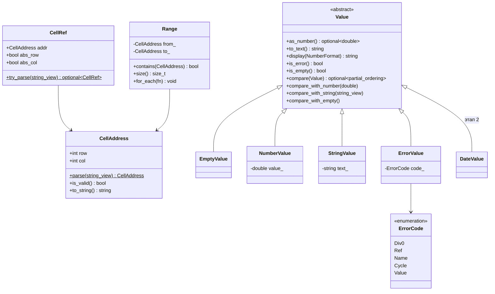
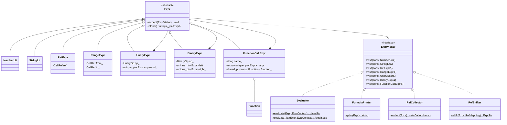
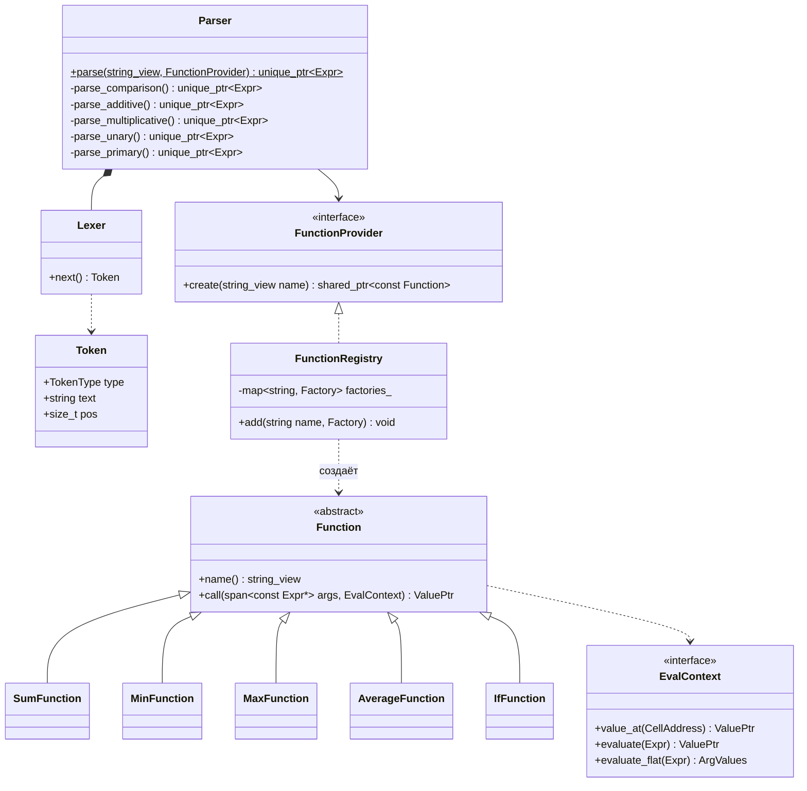
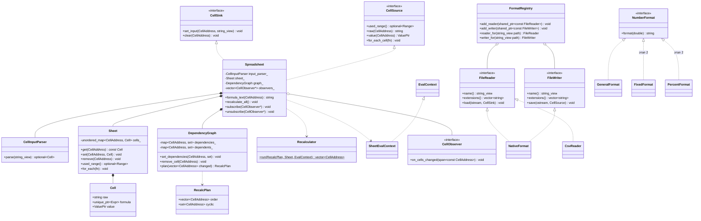
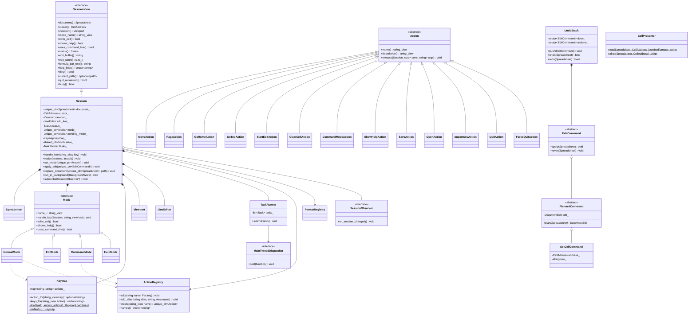
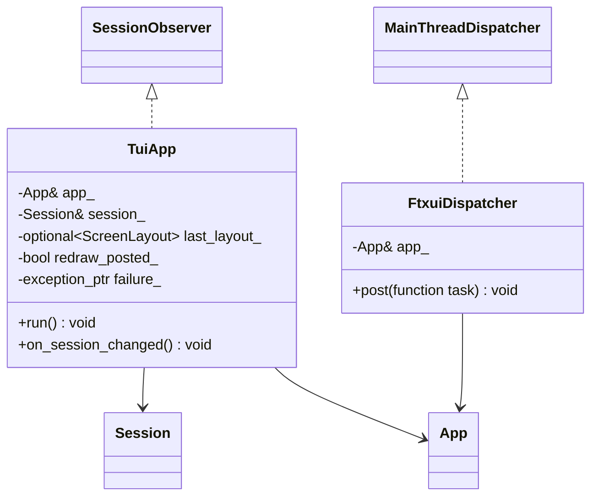

# Табличный процессор

## Диаграмма классов

Я разбил диаграмму на несколько частей, потому что одна общая получилась слишком большой. Имена на диаграммах такие же, как в коде.

### Адреса и значения

`CellAddress` это просто номер строки и столбца. `CellRef` это ссылка из формулы, в ней ещё есть флаги для `$`. На первом этапе они не нужны, но пригодятся при копировании.

Значения сделаны через наследование от `Value`. Так проще добавить новый тип, например дату. Ошибки вроде `#DIV/0!` тоже считаются значением, чтобы ошибка в одной ячейке не ломала остальные. Значение после создания не меняется, поэтому его можно делить через `shared_ptr` между ячейками и потоками.



Дату буду хранить как количество дней, тогда разность дат считается обычным вычитанием.

#### Как сравниваются значения

В формуле `=A1<B1` надо сравнить два значения, а их типы известны только во время работы. Писать `dynamic_cast` или `switch` по типу я не хотел, поэтому сделал двойную диспетчеризацию:

1. `lhs.compare(rhs)` попадает в класс левого значения, например в `NumberValue`. Теперь известно, что слева число.
2. Он вызывает `rhs.compare_with_number(своё число)`. Этот вызов попадает в класс правого значения, и теперь известны оба типа.

По умолчанию `compare_with_*` возвращает `nullopt` («сравнивать нельзя»), а наследник переопределяет только то, что умеет. Число со строкой не сравнивается, это `#VALUE!`. Пустая ячейка рядом с числом ведёт себя как 0, рядом со строкой как `""`. Строки сравниваются без учёта регистра латиницы.

### Формулы

Формула после разбора хранится как дерево. Например, `=A1*2+SUM(B1:B3)`: сверху плюс, слева от него умножение, справа функция.

С этим деревом надо делать несколько разных вещей: считать значение, печатать формулу обратно в текст, искать ссылки на другие ячейки. Каждое такое действие я вынес в отдельный класс-посетитель. Посетители получают узлы как `const`, дерево они не меняют.



Функцию узел хранит через `shared_ptr<const Function>`: у функций нет состояния, один объект делят все формулы. Если функции с таким именем нет, `function_` пустой, и при вычислении получается `#NAME?`.

### Парсер и функции

Парсер пишу сам. `Lexer` делит строку на токены (числа, ссылки, знаки), а `Parser` строит из них дерево методом рекурсивного спуска. Каждый метод отвечает за свой приоритет операций: сравнения, потом `+ -`, потом `* /`, потом унарный минус.

Парсер не знает, какие функции существуют. Когда он видит имя, например `SUM`, он спрашивает у `FunctionProvider`. Это интерфейс, поэтому в тестах парсеру можно дать подделку вместо настоящего реестра.

Аргументы функция получает ещё не посчитанными. Это нужно для `IF`: в `=IF(A1=0, 0, 1/A1)` деление не должно считаться, если A1 равно 0.



Встроенные функции регистрирует свободная функция `register_builtins(FunctionRegistry&)`, сам реестр про них не знает.

`evaluate_flat` нужен для `SUM(A1:A3, 5)`: функция просит развернуть аргумент, и диапазон превращается в список значений, а не в `#VALUE!`. Так функции не надо проверять, какой узел ей передали.

### Лист, граф зависимостей и файлы

`Sheet` хранит только заполненные ячейки, пустые не хранятся.

`DependencyGraph` помнит, какая ячейка от какой зависит. По нему видно, что надо пересчитать после изменения ячейки.

`Spreadsheet` это главный класс ядра. Всё остальное (лист, граф, парсер) используется через него.



`EvalContext` реализует не сам `Spreadsheet`, а внутренний `SheetEvalContext`. Иначе `evaluate` был бы публичным методом таблицы, а снаружи он никому не нужен.

Формату файла весь `Spreadsheet` не нужен. Читателю достаточно куда-то класть ячейки (`CellSink`), писателю — откуда-то их брать (`CellSource`).

#### Пересчёт

1. `plan(changed)` собирает все ячейки, которые зависят от изменённых (через сколько угодно шагов), вместе с самими изменёнными.
2. Для этих ячеек считается порядок алгоритмом Кана: ячейка идёт после всех, от кого она зависит.
3. То, что не попало в порядок, лежит в цикле или зависит от цикла. Это `cyclic`, там будет `#CYCLE!`.
4. `Recalculator` считает ячейки строго по порядку. К моменту вычисления ячейки все её зависимости уже свежие, поэтому каждая считается ровно один раз, и рекурсии между ячейками нет.

Диапазон `SUM(A1:A100)` записывается в граф как зависимость от каждой ячейки диапазона, даже пустой. Иначе ввод в пустую A50 не пересчитал бы сумму.

#### Строгая гарантия `set_input`

Если ввод неправильный (например, `=1+`), таблица должна остаться ровно такой, какой была. Поэтому `set_input` идёт так:

1. `CellInputParser` разбирает ввод. Если бросит `ParseError`, ещё ничего не изменено.
2. `RefCollector` собирает ссылки в новое множество. Тоже ничего не изменено.
3. `graph_.set_dependencies(...)` сначала строит новые множества и только потом меняет их местами через `swap`, который не бросает.
4. `sheet_.set(...)`. Если бросит (`bad_alloc` при вставке новой ячейки), граф откатывается.
5. Пересчёт и уведомление. Вычисление доменных исключений не бросает: ошибки в формулах это значения.

Файл тоже грузится не в текущую таблицу, а в новую `Spreadsheet`. Текущий документ заменяется, только если весь файл прочитался.

### Приложение

`Session` хранит всё, что относится к текущей работе: документ, курсор, режим, строку правки, сообщение в строке состояния. Нажатую клавишу она передаёт текущему режиму, потому что в разных режимах одна клавиша делает разное.

Какая клавиша что делает, написано в `Keymap`, он читается из конфига. Там клавише соответствует имя действия, а `ActionRegistry` создаёт по этому имени объект `Action`.



Все изменения документа идут через `apply_edit` и `EditCommand`, даже очистка ячейки. После удачного `apply` команда кладётся в `UndoStack`, а `ctrl+z` и `ctrl+y` зовут `Session::undo` и `redo`. Стек помнит 256 правок, память под него берётся сразу, поэтому `push` не бросает. Открыли или импортировали другой документ, стек очищается: старые команды помнят ячейки старого документа. После отмены документ считается изменённым, даже если вернулись к сохранённому.

Правка с отменой сделана через `PlannedCommand` (Template Method). Наследник только считает `DocumentEdit`: список ячеек с содержимым до и после. `apply` и `revert` у всех одинаковые: `Spreadsheet::apply(edit)` и `apply(edit.inverse())`. `Spreadsheet::apply` сначала разбирает весь ввод, поэтому при ошибке в формуле таблица не меняется. Пересчёт и уведомление идут один раз на всю правку. Если посреди кончится память, уже записанные ячейки возвращаются к старому содержимому.

Оформление ячеек (`CellStyle`: формат чисел и выравнивание) лежит отдельно от содержимого, в `StyleTable`. Поэтому очистка ячейки стиль не снимает, а `used_range` и пересчёт про стили не знают.

`Session` не подписана на `Spreadsheet` как `CellObserver`: все изменения документа и так проходят через неё. Интерфейс подписывается на `Session` через `SessionObserver` и после каждой клавиши получает сигнал «перерисуйся».

#### Отложенная смена режима

Режим меняется изнутри самого режима. Например, `HelpMode::handle_key` на любую клавишу вызывает `session.set_mode(NormalMode)`. Если бы `set_mode` сразу заменил `unique_ptr`, объект `HelpMode` удалился бы, пока выполняется его метод. Любое обращение к его полю после этого было бы чтением освобождённой памяти.

Поэтому внутри `handle_key` новый режим кладётся в `pending_mode_`, а включает его `Session::handle_key` после того, как старый режим вернул управление. Если клавиша закончилась ошибкой, смена режима отменяется. Поэтому при битой формуле остаёмся в правке, а набранный текст не пропадает. Тест `OldModeLivesUntilItReturns` под ASan падает, если смену сделать сразу.

#### Потоки

Файл может быть большим, поэтому `open` и `import-csv` читают его в фоне, а интерфейс в это время работает.

- `TaskRunner` запускает работу в `std::jthread`. Работа возвращает продолжение, а `TaskRunner` отправляет его в главный поток через `MainThreadDispatcher` (в программе это `FtxuiDispatcher` поверх `App::Post` из FTXUI, в тестах очередь `ManualDispatcher`).
- В фоне читается файл в новую `Spreadsheet`. Трогаются только реестры функций и форматов, а их никто не меняет. Сам сеанс в фоне не используется.
- Состояние `Session` меняет только продолжение в главном потоке, поэтому мьютексов вокруг документа нет.
- Исключение из фона не может вылететь из потока (будет `std::terminate`). Оно переносится в главный поток через `exception_ptr` и показывается в статусе.
- `TaskRunner` последнее поле `Session`, он уничтожается первым: просит потоки остановиться и дожидается их, пока остальные поля ещё живы.
- Продолжение могло уже стоять в очереди, когда сеанс удалили. Поэтому оно держит `weak_ptr` на `alive_` сеанса и ничего не делает, если тот истёк. Проверка и удаление сеанса идут в одном главном потоке, так что они не пересекутся.

### Интерфейс

Слой интерфейса только переводит клавиши в строки и рисует то, что отдаёт `SessionView`. Логики таблицы в нём нет.



Остальное сделано свободными функциями: у них нет состояния, и подменять их незачем.

- `key_name` переводит событие FTXUI в имя клавиши. Всё незнакомое даёт `nullopt`: терминал присылает ответы на свои запросы теми же событиями, и в сеанс они попасть не должны.
- `compute_layout` считает, сколько строк и столбцов влезает в окно.
- `fit_cell` и `caret_window` подгоняют UTF-8 под ширину в экранных позициях, потому что байт, символ и позиция на экране это разные вещи.
- `render_screen` строит экран по `SessionView` и ничего не меняет. Поэтому тесты рисуют его в память и проверяют символы по координатам, терминал им не нужен.

Путь клавиши: FTXUI выдаёт событие, `key_name` делает из него строку, `TuiApp` вызывает `session.handle_key`, режим находит действие, а действие меняет сеанс. Сеанс вызывает `on_session_changed`, и рисуется новый кадр.

Что рисовать, интерфейс узнаёт от режима через `edits_cell`, `shows_help` и `uses_command_line`. Сравнивать `mode_name()` со строками было бы проверкой типа в обход полиморфизма, и новый режим потребовал бы правки интерфейса. Имя режима только печатается в строке состояния.

`on_session_changed` отправляет `Event::Custom`. Без этого экран не обновился бы после фоновой загрузки: `App::Post` выполняет задачу, но кадр устаревшим не считает.

Размер окна сверяется перед каждым кадром, и `session.resize` вызывается, только если он изменился. Так одним кодом обрабатываются и первый кадр, и изменение окна.

Порядок объявлений в `main` важен: реестры, `App`, `FtxuiDispatcher`, `Session`, `TuiApp`. Сеанс уничтожается раньше `App` и в деструкторе дожидается фоновых потоков, поэтому они не обратятся к уже удалённому `App`.

Исключение, которое сеанс не обработал, нельзя пропускать сквозь цикл FTXUI, иначе терминал останется в сыром режиме. `TuiApp` запоминает его в `exception_ptr`, выходит из цикла и бросает его из `run`. Ctrl+C и Ctrl+Z перехвачены, чтобы случайное нажатие не закрыло программу с несохранённой таблицей.

## Слои и зависимости между ними

Программа состоит из трёх слоёв:

- `ss_core` — ядро: ячейки, формулы, пересчёт, сохранение и загрузка. Про терминал ничего не знает.
- `ss_app` — логика работы с программой: курсор, режимы, клавиши, команды, фоновые задачи.
- `ss_tui` и `spreadsheet` — интерфейс на FTXUI. `ss_tui` рисует таблицу и передаёт нажатия клавиш в `ss_app`, а `spreadsheet` это маленький исполняемый файл с `main`, где всё собирается вместе.

Зависимости идут только вниз: интерфейс использует `ss_app`, `ss_app` использует `ss_core`. FTXUI подключен только к `ss_tui`. Это проверяет `cmake/CheckLayering.cmake`: если `ss_core` или `ss_app` линкуются с FTXUI или подключают его заголовки, CMake остановится с ошибкой.

Клавиши передаются в `ss_app` просто строками, например `"enter"` или `"ctrl+s"`. Тогда `ss_app` тоже не зависит от FTXUI. Тесты есть для всех слоёв: `core_tests`, `app_tests` и `tui_tests`.

## Ошибки

```
std::runtime_error
└── ss::core::Error            корень всех наших ошибок
    ├── AddressError           "A0", "ZZZ99999999"
    ├── ParseError             + position(), ошибка в формуле
    ├── FileFormatError        + line(), битый файл
    ├── LimitError             выход за пределы листа
    ├── ss::app::ConfigError   кривая клавиша в конфиге
    └── ss::app::CommandError  неизвестная команда ":xyz"
```

`Session::handle_key` ловит `ss::core::Error` и пишет сообщение в строку состояния, программа работает дальше. Ошибки внутри формул (`#DIV/0!` и т.д.) это не исключения, а значения.

## Точки расширения

Каждая из них делается новым классом и одной строкой регистрации. В `tests/core/test_extensions.cpp` и `tests/app/test_extensions.cpp` так сделаны функция `COUNT`, чтение `.tsv`, формат чисел `FixedFormat(2)` и действие `go-end`. Ни один существующий класс для них не менялся.

- **Новая функция в формулах.** Наследник `Function` и строка в `register_builtins`. Парсер менять не надо.
- **Новый тип значения.** Наследник `Value` с `as_number()`, `to_text()`, `display()` и нужными `compare_with_*`.
- **Новый формат файла.** Наследник `FileReader` и/или `FileWriter` и строка в `register_formats`. Формат выбирается по расширению файла.
- **Новый формат чисел** (этап 2). Наследник `NumberFormat`.
- **Новое действие.** Наследник `Action` и строка в `register_actions`. Оно сразу доступно из командной строки и конфига клавиш и само попадает в справку.
- **Новая операция с отменой.** Наследник `PlannedCommand` с одним методом `plan` и `Action`, который его запускает.

## Паттерны

### Composite — дерево формулы

Формула может быть вложенной, например `=IF(A1>0, SUM(B1:B3)*2, -C1)`. Поэтому я храню её деревом: у каждого узла есть свои дочерние узлы.

Можно было хранить формулу строкой и каждый раз разбирать заново, но это медленно. Ещё был вариант с обратной польской записью, но с ней сложно сделать `IF` и печать формулы обратно в текст.

### Visitor — операции над деревом формулы

С деревом нужно делать разные вещи: считать, печатать, искать ссылки, а на втором этапе ещё сдвигать ссылки. Если сделать для этого методы в каждом узле, то при каждой новой операции придётся менять все классы узлов. С посетителем новая операция — это просто новый класс.

Минус в том, что при добавлении нового вида узла придётся менять всех посетителей. Но виды узлов почти не меняются, а новые функции добавляются через `Function`, так что это не проблема.

### Фабрика — FunctionRegistry

Парсеру нужно создать функцию по её имени из формулы. Можно было написать `if (name == "SUM") ... else if ...`, но тогда для каждой новой функции пришлось бы менять парсер. Вместо этого есть реестр, где по имени лежит функция, создающая нужный объект.

`ActionRegistry` и `FormatRegistry` устроены так же: первый создаёт действие по имени из конфига или командной строки, второй выбирает формат по расширению файла.

### Observer — уведомления об изменениях

Когда что-то поменялось, интерфейсу нужно перерисоваться, но `ss_app` ничего не должен знать про интерфейс. Поэтому `Session` сообщает подписчикам (`SessionObserver`, это `TuiApp`). Так же интерфейс узнаёт, что закончилась фоновая загрузка файла. `Spreadsheet` тоже сообщает своим подписчикам (`CellObserver`), какие ячейки изменились, одним вызовом на всю операцию.

Сначала я хотел подписывать ячейки друг на друга, но тогда некоторые ячейки пересчитывались бы по два раза, и циклы было бы трудно находить. Поэтому порядок пересчёта определяет граф зависимостей.

### Command — действия и правки

Клавиши берутся из конфига, поэтому каждое действие сделано отдельным объектом с именем. Со `switch` по клавишам переназначить их из файла не получилось бы.

Правки документа (`EditCommand`) — тоже команды: каждая умеет и выполниться, и откатиться. На этом работает отмена через `UndoStack`. Сохранять перед каждым изменением копию всей таблицы заняло бы слишком много памяти, а команда помнит только тронутые ячейки.

### State — режимы

В программе есть несколько режимов: обычный, редактирование ячейки, ввод команды и справка. В каждом режиме клавиши работают по-своему. Если делать это через `switch` по режиму, одна функция получится огромной. Поэтому каждый режим — отдельный класс.

### Strategy — форматы файлов и чисел

Таблицу можно читать и сохранять в разных форматах. Каждый формат — отдельный класс с интерфейсом `FileReader` или `FileWriter`. Иначе пришлось бы писать методы `saveCsv`, `loadCsv` и т.д. прямо в `Spreadsheet`.

На втором этапе форматы чисел (`NumberFormat`) будут устроены так же, `FixedFormat` уже показан в тестах.

### Facade — Spreadsheet

Чтобы записать значение в ячейку, нужно разобрать формулу, обновить граф, пересчитать ячейки и сообщить подписчикам. Всё это делает `Spreadsheet`, а `ss_app` вызывает только `set_input`. Так проще следить, чтобы при ошибке таблица не испортилась.

### Другие

- Слои: `ss_core`, `ss_app` и интерфейс (описаны выше).
- MVC: модель — `Spreadsheet` и `Session`, контроллер — режимы и действия, вид — `render_screen`, который читает `SessionView`.
- Adapter: `FtxuiDispatcher` приводит `App::Post` из FTXUI к интерфейсу `MainThreadDispatcher`. Иначе `ss_app` пришлось бы знать про FTXUI или передавать ему голую `std::function`, а так в тестах вместо него стоит `ManualDispatcher`.

## Что изменилось по сравнению с первой версией

Пока я писал код, часть решений из первой версии этого документа пришлось поменять.

| Было | Стало | Почему |
|---|---|---|
| `FileFormat { load; save }` | `FileReader` и `FileWriter` | CSV на первом этапе только читается, иначе `save` был бы заглушкой (LSP, ISP) |
| `load(istream, Spreadsheet)` | `load(istream, CellSink&)`, `save(ostream, const CellSource&)` | формату не нужна вся таблица (ISP) |
| `Parser` зависит от `FunctionRegistry` | от интерфейса `FunctionProvider` | парсер можно тестировать с подделкой (DIP) |
| `FunctionRegistry::withBuiltins()` | свободная `register_builtins(FunctionRegistry&)` | реестр не должен знать конкретные функции (OCP) |
| узел владеет `unique_ptr<Function>` | `shared_ptr<const Function>` | функции без состояния, а `clone()` должен копировать узел без реестра |
| `EvalContext { valueAt, evaluate }` | плюс `evaluate_flat` | `SUM(A1:A3, 5)` разворачивает диапазон без `dynamic_cast` |
| `Spreadsheet` реализует `EvalContext` | внутренний `SheetEvalContext` | `evaluate` не нужен в публичном API таблицы (ISP, SRP) |
| нет | `CellInputParser`, `Recalculator` | вынесены из `Spreadsheet` (SRP) |
| `affectedInOrder` и `cycleThrough` | один `plan(changed)` с `order` и `cyclic` | один обход графа вместо двух |
| `Action::execute(Session)` | `execute(Session&, span<const string> args)` | командам `:w файл`, `:e файл` нужны аргументы |
| `EditCommand` только на этапе 2 | уже сейчас, через `SetCellCommand` | все правки сразу идут через команды, и undo потом не потребует переделок (OCP) |
| `Session` подписана на `Spreadsheet` | не подписана | все изменения документа и так идут через `Session` |
| `Keymap::load(path)` | `load(path, known_actions)` | неизвестное действие в конфиге видно сразу, с номером строки |
| нет | `MainThreadDispatcher`, `SessionView`, `CellPresenter`, `LineEditor` | `ss_app` не зависит от FTXUI (DIP), в TUI не остаётся логики |
| `CellStyle` в `Cell` | отдельная `StyleTable` в `Spreadsheet` | у пустой ячейки тоже бывает стиль, а пересчёту и графу он не нужен |
| `spreadsheet` одной целью | библиотека `ss_tui` и маленький `spreadsheet` | иначе код интерфейса нечем подключить к тестам |
| `screen.Post` | `App::Post` | в FTXUI 7 `ScreenInteractive` переименован в `App` |
| перерисовка сама после `Post` | `on_session_changed` отправляет `Event::Custom` | `Post` с функцией не обновляет кадр |
| интерфейс знает только `mode_name()` | ещё `edits_cell`, `shows_help`, `uses_command_line` | иначе пришлось бы сравнивать имена режимов |
