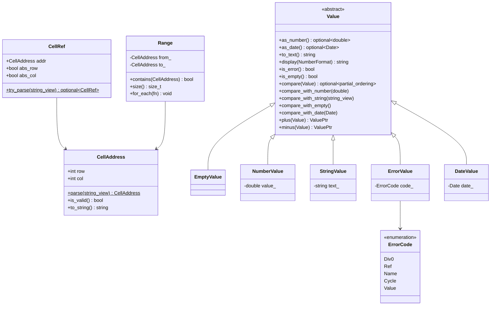
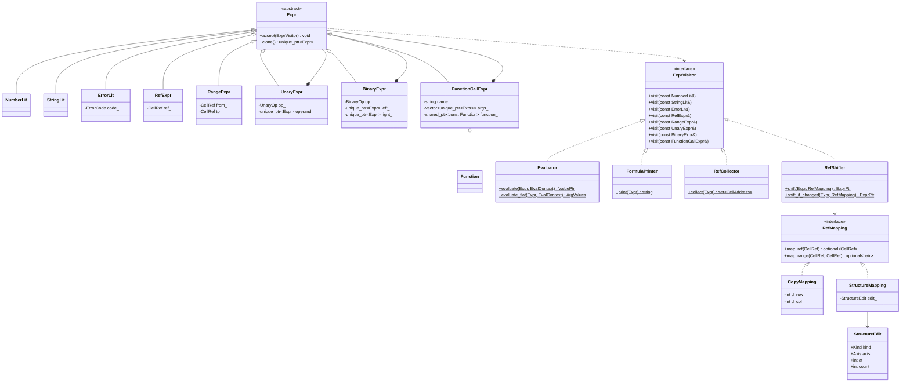
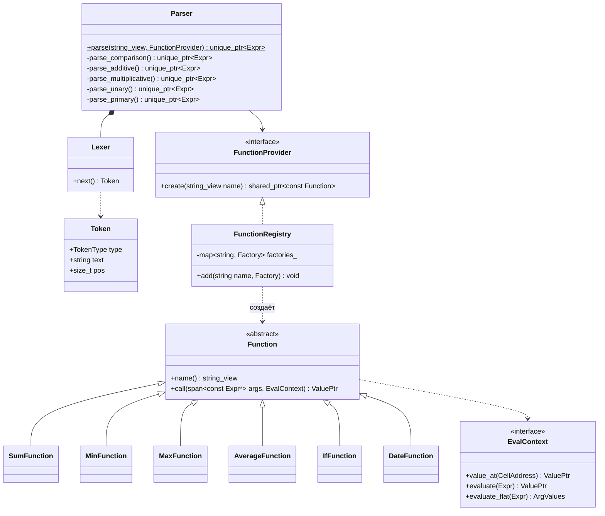
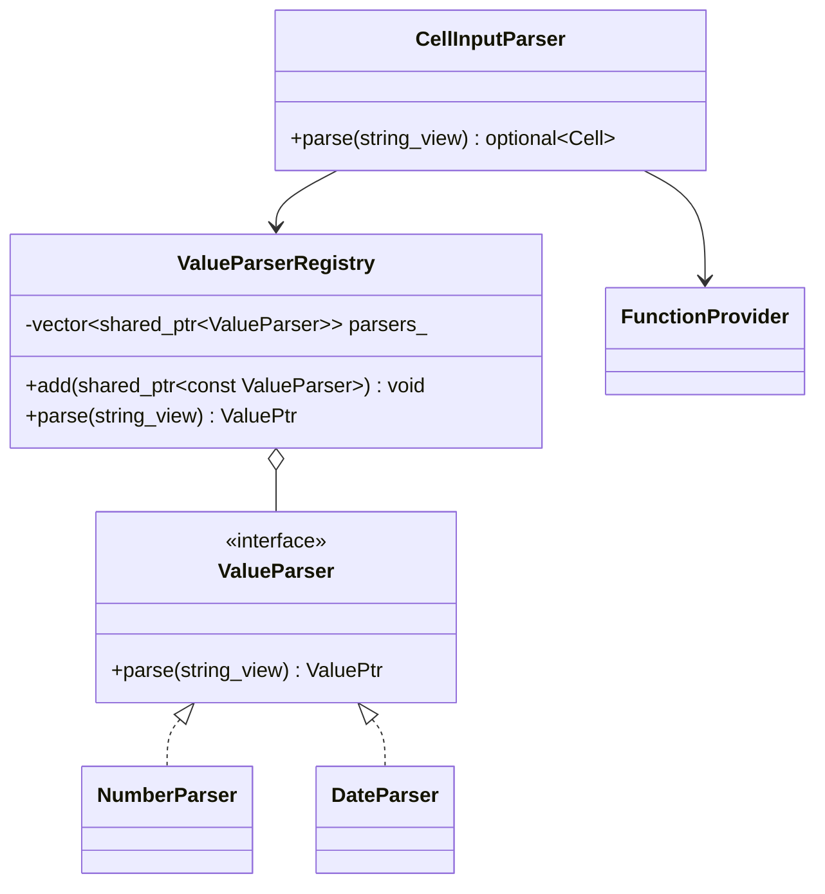
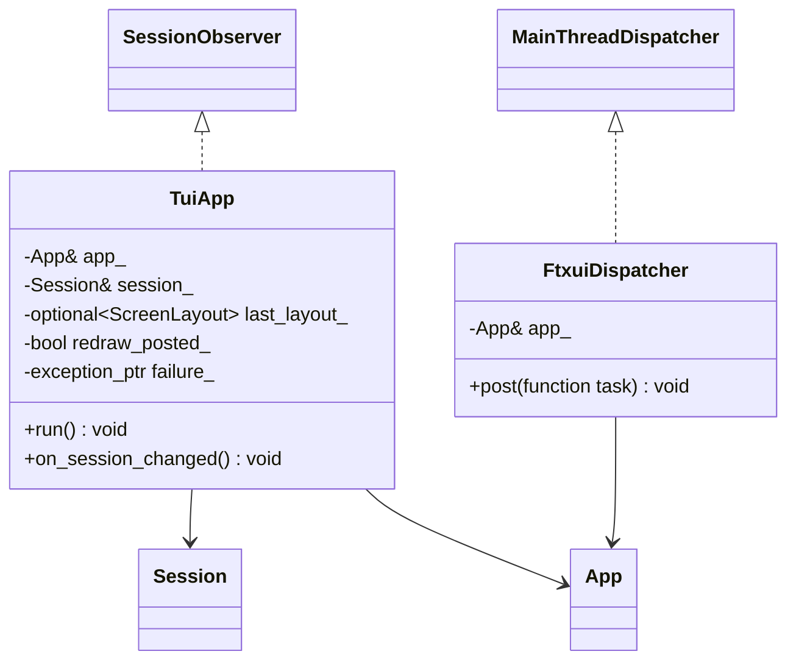

# Табличный процессор

## Диаграмма классов

Я разбил диаграмму на несколько частей, потому что одна общая получилась слишком большой. Имена на диаграммах такие же, как в коде.

### Адреса и значения

`CellAddress` это просто номер строки и столбца. `CellRef` это ссылка из формулы, в ней ещё есть флаги для `$`. На вычисление они не влияют, а нужны при копировании: часть ссылки с `$` остаётся на месте, часть без него сдвигается.

Значения сделаны через наследование от `Value`. Так проще добавить новый тип: дата появилась как ещё один наследник. Ошибки вроде `#DIV/0!` тоже считаются значением, чтобы ошибка в одной ячейке не ломала остальные. Значение после создания не меняется, поэтому его можно делить через `shared_ptr` между ячейками и потоками.



Дата хранится как количество дней от 1970-01-01 (`std::chrono::sys_days`), поэтому разность дат это обычное вычитание. `as_number()` у даты возвращает это число дней, и `SUM`, `MIN`, `MAX` работают с датами без правок. Вводить дату можно как `2024-03-15` или `15.03.2024`, показывается она всегда в первом виде. Дата, которой не бывает (`31.02.2024`), остаётся текстом.

#### Своя арифметика значения

`=A1-B1` для двух дат должно дать число дней, а `=A1+30` дату. Чтобы `Evaluator` не проверял типы, у `Value` есть `plus` и `minus`. По умолчанию они возвращают `nullptr`, то есть «ничего особенного, считай как числа». `DateValue` их переопределяет: дата минус дата это число, дата плюс или минус число это дата, две даты складывать нельзя (`#VALUE!`). `Evaluator` сначала спрашивает сами значения и только потом считает числами. Сложение он спрашивает у обоих операндов, поэтому `=30+A1` тоже дата. Если результат выходит за годы 0001–9999, получается `#VALUE!`.

Новому типу со своей арифметикой править `Evaluator` не придётся.

#### Как сравниваются значения

В формуле `=A1<B1` надо сравнить два значения, а их типы известны только во время работы. Писать `dynamic_cast` или `switch` по типу я не хотел, поэтому сделал двойную диспетчеризацию:

1. `lhs.compare(rhs)` попадает в класс левого значения, например в `NumberValue`. Теперь известно, что слева число.
2. Он вызывает `rhs.compare_with_number(своё число)`. Этот вызов попадает в класс правого значения, и теперь известны оба типа.

По умолчанию `compare_with_*` возвращает `nullopt` («сравнивать нельзя»), а наследник переопределяет только то, что умеет. Число со строкой не сравнивается, это `#VALUE!`. Пустая ячейка рядом с числом ведёт себя как 0, рядом со строкой как `""`. Строки сравниваются без учёта регистра латиницы. Дата сравнивается только с датой и с пустой ячейкой, которая считается раньше любой даты.

### Формулы

Формула после разбора хранится как дерево. Например, `=A1*2+SUM(B1:B3)`: сверху плюс, слева от него умножение, справа функция.

С этим деревом надо делать несколько разных вещей: считать значение, печатать формулу обратно в текст, искать ссылки на другие ячейки, сдвигать ссылки. Каждое такое действие я вынес в отдельный класс-посетитель. Посетители получают узлы как `const`, дерево они не меняют.



Функцию узел хранит через `shared_ptr<const Function>`: у функций нет состояния, один объект делят все формулы. Если функции с таким именем нет, `function_` пустой, и при вычислении получается `#NAME?`.

#### Сдвиг ссылок

Ссылки в формулах приходится менять в двух случаях: формулу скопировали в другое место или в лист вставили (удалили) строки и столбцы. Обход дерева в обоих случаях одинаковый, отличается только правило, что делать с одной ссылкой. Поэтому обходит дерево один посетитель `RefShifter`, а правило ему передаётся объектом `RefMapping`:

- `CopyMapping(d_row, d_col)` сдвигает части ссылки без `$`, части с `$` оставляет. Если ссылка ушла за лист, её больше нет.
- `StructureMapping` двигает все ссылки, `$` тут ни при чём. Правила как в Excel:

| Что сделали | Ссылка или диапазон | Что получится |
|---|---|---|
| вставили строку перед 3 | `A5` | `A6` |
| вставили строку перед 3 | `A1:A5` | `A1:A6`, диапазон растянулся |
| вставили строку перед 3 | `A3:A5` | `A4:A6`, сдвинулся целиком |
| удалили строку 3 | `A3` | `#REF!` |
| удалили строку 3 | `A5` | `A4` |
| удалили строку 5 | `A1:A5` | `A1:A4`, диапазон сжался |
| удалили строки 2–3 | `A2:A3` | `#REF!` |

`RefShifter` строит новое дерево, а не правит старое. Узлы остаются неизменяемыми, и если посреди обхода случится исключение, исходная формула не пострадает.

Когда ссылки больше нет, на её место ставится узел `ErrorLit` с кодом `#REF!`. Отдельный узел нужен потому, что формула хранится в ячейке текстом (`raw`): после удаления строки она выглядит как `=#REF!+1`, сохраняется в файл и должна читаться обратно. Поэтому лексер и парсер понимают `#REF!` в формуле. Другие ошибки в формуле написать нельзя.

Формулу, в которой ни одна ссылка не изменилась, `rewrite_formula` возвращает как была, чтобы не менять то, как её написал пользователь.

### Парсер и функции

Парсер пишу сам. `Lexer` делит строку на токены (числа, ссылки, знаки), а `Parser` строит из них дерево методом рекурсивного спуска. Каждый метод отвечает за свой приоритет операций: сравнения, потом `+ -`, потом `* /`, потом унарный минус.

Парсер не знает, какие функции существуют. Когда он видит имя, например `SUM`, он спрашивает у `FunctionProvider`. Это интерфейс, поэтому в тестах парсеру можно дать подделку вместо настоящего реестра.

Аргументы функция получает ещё не посчитанными. Это нужно для `IF`: в `=IF(A1=0, 0, 1/A1)` деление не должно считаться, если A1 равно 0.



Встроенные функции регистрирует свободная функция `register_builtins(FunctionRegistry&)`, сам реестр про них не знает.

`evaluate_flat` нужен для `SUM(A1:A3, 5)`: функция просит развернуть аргумент, и диапазон превращается в список значений, а не в `#VALUE!`. Так функции не надо проверять, какой узел ей передали.

Функция `DATE(год, месяц, день)` добавлена так же, как любая новая: класс `DateFunction` и строка в `register_builtins`. Парсер для неё не менялся.

#### Что ввели в ячейку

Формула это не единственное, что надо разобрать. `CellInputParser` смотрит на ввод по порядку: пусто значит очистить ячейку, `=` в начале значит формула, апостроф значит текст. Всё остальное он показывает разборщикам значений из `ValueParserRegistry`. Каждый `ValueParser` либо узнаёт свой тип и возвращает значение, либо возвращает `nullptr`. Первый узнавший побеждает, а если не узнал никто, в ячейке текст.



Числа и даты регистрирует `register_value_parsers`. Раньше число читалось прямо в `CellInputParser`, и для даты туда пришлось бы дописывать ещё одну ветку, а потом ещё одну для каждого нового типа.

### Лист, граф зависимостей и файлы

`Sheet` хранит только заполненные ячейки, пустые не хранятся.

`DependencyGraph` помнит, какая ячейка от какой зависит. По нему видно, что надо пересчитать после изменения ячейки.

`Spreadsheet` это главный класс ядра. Всё остальное (лист, граф, парсер) используется через него. Кроме ячеек он хранит оформление: стили ячеек в `StyleTable` и ширины столбцов в `ColumnWidths`.

```mermaid
classDiagram
    class Cell {
        +string raw
        +unique_ptr~Expr~ formula
        +ValuePtr value
    }
    class CellInputParser {
        +parse(string_view) optional~Cell~
    }
    class Sheet {
        -unordered_map~CellAddress, Cell~ cells_
        +get(CellAddress) const Cell*
        +set(CellAddress, Cell) void
        +remove(CellAddress) void
        +used_range() optional~Range~
        +for_each(fn) void
    }
    Sheet *-- Cell

    class DependencyGraph {
        -map~CellAddress, set~ dependencies_
        -map~CellAddress, set~ dependents_
        +set_dependencies(CellAddress, set) void
        +remove_cell(CellAddress) void
        +plan(vector~CellAddress~ changed) RecalcPlan
    }
    class RecalcPlan {
        +vector~CellAddress~ order
        +set~CellAddress~ cyclic
    }
    class Recalculator {
        +run(RecalcPlan, Sheet, EvalContext) vector~CellAddress~$
    }
    DependencyGraph ..> RecalcPlan

    class CellSink {
        <<interface>>
        +set_input(CellAddress, string_view) void
        +clear(CellAddress) void
        +set_style(CellAddress, CellStyle) void
        +set_column_width(int col, int width) void
    }
    class CellSource {
        <<interface>>
        +used_range() optional~Range~
        +raw(CellAddress) string
        +value(CellAddress) ValuePtr
        +for_each_cell(fn) void
        +for_each_style(fn) void
        +column_widths() ColumnWidths
    }
    class Spreadsheet {
        -CellInputParser input_parser_
        -Sheet sheet_
        -DependencyGraph graph_
        -StyleTable styles_
        -ColumnWidths widths_
        -vector~CellObserver*~ observers_
        +apply(DocumentEdit) void
        +content(CellAddress) CellContent
        +style(CellAddress) CellStyle
        +formula_text(CellAddress) string
        +recalculate_all() void
        +subscribe(CellObserver*) void
        +unsubscribe(CellObserver*) void
    }
    class CellStyle {
        +string format
        +optional~Align~ align
    }
    class StyleTable {
        -unordered_map~CellAddress, CellStyle~ styles_
        +get(CellAddress) CellStyle
        +set(CellAddress, CellStyle) void
        +for_each(fn) void
    }
    class ColumnWidths {
        -map~int, int~ widths_
        +get(int col) int
        +set(int col, int width) void
    }
    class CellContent {
        +string raw
        +CellStyle style
    }
    class CellChange {
        +CellAddress address
        +CellContent before
        +CellContent after
    }
    class DocumentEdit {
        +vector~CellChange~ cells
        +optional~ColumnWidths~ widths_before
        +optional~ColumnWidths~ widths_after
        +inverse() DocumentEdit
    }
    StyleTable *-- CellStyle
    CellContent *-- CellStyle
    CellChange *-- CellContent
    DocumentEdit *-- CellChange
    Spreadsheet ..> DocumentEdit
    CellSink <|.. Spreadsheet
    CellSource <|.. Spreadsheet
    Spreadsheet *-- CellInputParser
    Spreadsheet *-- Sheet
    Spreadsheet *-- DependencyGraph
    Spreadsheet *-- StyleTable
    Spreadsheet *-- ColumnWidths
    Spreadsheet ..> Recalculator
    Spreadsheet ..> SheetEvalContext
    Spreadsheet o-- CellObserver
    class SheetEvalContext
    EvalContext <|.. SheetEvalContext

    class CellObserver {
        <<interface>>
        +on_cells_changed(span~const CellAddress~) void
    }

    class FileReader {
        <<interface>>
        +name() string_view
        +extensions() vector~string~
        +load(istream, CellSink) void
    }
    class FileWriter {
        <<interface>>
        +name() string_view
        +extensions() vector~string~
        +save(ostream, CellSource) void
        +keeps_formulas() bool
    }
    class NativeFormat
    class CsvReader
    class CsvWriter
    FileReader <|.. NativeFormat
    FileWriter <|.. NativeFormat
    FileReader <|.. CsvReader
    FileWriter <|.. CsvWriter
    class FormatRegistry {
        +add_reader(shared_ptr~const FileReader~) void
        +add_writer(shared_ptr~const FileWriter~) void
        +reader_for(string_view path) FileReader
        +writer_for(string_view path) FileWriter
    }
    FormatRegistry o-- FileReader
    FormatRegistry o-- FileWriter

    class NumberFormat {
        <<interface>>
        +format(double) string
    }
    class GeneralFormat
    class FixedFormat {
        -int digits_
    }
    class PercentFormat {
        -int digits_
    }
    NumberFormat <|.. GeneralFormat
    NumberFormat <|.. FixedFormat
    NumberFormat <|.. PercentFormat
    class NumberFormatRegistry {
        -map~string, Factory~ factories_
        +add(string name, Factory) void
        +create(string_view spec) shared_ptr~const NumberFormat~
        +make_spec(string_view name, int digits) string
    }
    NumberFormatRegistry ..> NumberFormat : создаёт
```



`EvalContext` реализует не сам `Spreadsheet`, а внутренний `SheetEvalContext`. Иначе `evaluate` был бы публичным методом таблицы, а снаружи он никому не нужен.

Формату файла весь `Spreadsheet` не нужен. Читателю достаточно куда-то класть ячейки (`CellSink`), писателю — откуда-то их брать (`CellSource`). Через них же идут стили и ширины столбцов.

`CsvWriter` пишет значения, а не формулы. Поэтому у `FileWriter` есть `keeps_formulas()`: у CSV он возвращает `false`, и команда `:w файл.csv` отказывается работать и советует `:export`. Иначе формулы молча пропали бы, а файл без них стал бы текущим документом.

#### Оформление

Стиль ячейки (`CellStyle`) это формат чисел и выравнивание. Он лежит не в `Cell`, а в отдельной `StyleTable`. Поэтому очистка ячейки стиль не снимает, стиль бывает у пустой ячейки и не влияет на `used_range`, а пересчёт и граф про стили не знают.

Формат чисел записан в стиле строкой, например `fixed:2` или `percent:1`, пустая строка значит обычный формат. Объект `NumberFormat` по этой строке создаёт `NumberFormatRegistry`. Строка, а не указатель на объект, потому что стиль сохраняется в файл и копируется вместе с ячейкой. Неизвестный формат из файла (его мог записать кто-то с другим набором форматов) показывается как обычное число и при сохранении пишется обратно как был.

Выравнивание в стиле необязательное. Если его нет, числа и даты прижимаются вправо, остальное влево.

`ColumnWidths` хранит только ширины, которые отличаются от обычной (10 позиций). Ширина бывает от 3 до 60.

#### Пересчёт

1. `plan(changed)` собирает все ячейки, которые зависят от изменённых (через сколько угодно шагов), вместе с самими изменёнными.
2. Для этих ячеек считается порядок алгоритмом Кана: ячейка идёт после всех, от кого она зависит.
3. То, что не попало в порядок, лежит в цикле или зависит от цикла. Это `cyclic`, там будет `#CYCLE!`.
4. `Recalculator` считает ячейки строго по порядку. К моменту вычисления ячейки все её зависимости уже свежие, поэтому каждая считается ровно один раз, и рекурсии между ячейками нет.

Диапазон `SUM(A1:A100)` записывается в граф как зависимость от каждой ячейки диапазона, даже пустой. Иначе ввод в пустую A50 не пересчитал бы сумму.

#### Одна операция на все изменения

Вставка строки меняет тысячи ячеек, а обратной операцией её не вернуть: после удаления строки в формулах уже стоит `#REF!`, и какая там была ссылка, неизвестно. Поэтому любая правка сначала считается как список изменений `DocumentEdit`, таблица при этом не трогается. В списке для каждой ячейки записано, что в ней было (`before`) и что станет (`after`), вместе со стилем. Применяет список один метод `Spreadsheet::apply`.

Что это даёт:

- отмена это `apply(edit.inverse())`, где `before` и `after` поменяны местами. Отдельная логика отмены для каждой команды не нужна;
- пересчёт и уведомление наблюдателей идут один раз на всю правку, сколько бы ячеек в ней ни было;
- весь ввод разбирается до первого изменения, поэтому `ParseError` и `LimitError` оставляют таблицу нетронутой.

Что будет при исключении посреди `apply`. После разбора бросить может только нехватка памяти. Каждая ячейка ставится в граф и лист целиком, так что они не расходятся. Если на какой-то ячейке всё же случилось исключение, уже записанные ячейки и ширины возвращаются к `before`, и исключение летит дальше. Сам откат `noexcept`: если памяти не хватило и на него, таблица остаётся согласованной, но правка применена частично. То есть гарантия строгая для ошибок пользователя и базовая для нехватки памяти.

Вставку и удаление строк и столбцов считает функция `plan_structure_edit`. Она собирает все ячейки листа (заполненные и пустые со стилем), для каждой находит новое место и переписывает формулу через `rewrite_formula`. Формулы меняются во всём листе, а не только в сдвинутых ячейках: `=A10` в первой строке после вставки строки 5 должна стать `=A11`. Вместе с ячейками переезжают стили, а при работе со столбцами ещё и ширины. Если вставка вытолкнула бы заполненную ячейку за край листа, функция бросает `LimitError`, и ничего не меняется.

#### Строгая гарантия `set_input`

Если ввод неправильный (например, `=1+`), таблица должна остаться ровно такой, какой была. Поэтому `set_input` идёт так:

1. `CellInputParser` разбирает ввод. Если бросит `ParseError`, ещё ничего не изменено.
2. `RefCollector` собирает ссылки в новое множество. Тоже ничего не изменено.
3. `graph_.set_dependencies(...)` сначала строит новые множества и только потом меняет их местами через `swap`, который не бросает.
4. `sheet_.set(...)`. Если бросит (`bad_alloc` при вставке новой ячейки), граф откатывается.
5. Пересчёт и уведомление. Вычисление доменных исключений не бросает: ошибки в формулах это значения.

Файл тоже грузится не в текущую таблицу, а в новую `Spreadsheet`. Текущий документ заменяется, только если весь файл прочитался.

### Приложение

`Session` хранит всё, что относится к текущей работе: документ, курсор, режим, строку правки, сообщение в строке состояния. Нажатую клавишу она передаёт текущему режиму, потому что в разных режимах одна клавиша делает разное.

Какая клавиша что делает, написано в `Keymap`, он читается из конфига. Там клавише соответствует имя действия, а `ActionRegistry` создаёт по этому имени объект `Action`.

```mermaid
classDiagram
    class SessionView {
        <<interface>>
        +document() Spreadsheet
        +number_formats() NumberFormatRegistry
        +cursor() CellAddress
        +selection() optional~Range~
        +viewport() Viewport
        +mode_name() string_view
        +edits_cell() bool
        +shows_help() bool
        +uses_command_line() bool
        +status() Status
        +edit_buffer() string
        +edit_caret() size_t
        +formula_bar_text() string
        +help_lines() vector~string~
        +help_scroll() int
        +dirty() bool
        +current_path() optional~path~
        +quit_requested() bool
        +busy() bool
    }
    class Session {
        -unique_ptr~Spreadsheet~ document_
        -CellAddress cursor_
        -optional~CellAddress~ selection_anchor_
        -optional~Clipboard~ clipboard_
        -Viewport viewport_
        -LineEditor edit_line_
        -Status status_
        -UndoStack history_
        -unique_ptr~Mode~ mode_
        -unique_ptr~Mode~ pending_mode_
        -Keymap keymap_
        -shared_ptr~bool~ alive_
        -TaskRunner tasks_
        +handle_key(string_view key) void
        +resize(int rows, int grid_width) void
        +set_mode(unique_ptr~Mode~) void
        +apply_edit(unique_ptr~EditCommand~) void
        +undo() bool
        +redo() bool
        +start_selection() void
        +target_range() Range
        +set_clipboard(Clipboard) void
        +replace_document(unique_ptr~Spreadsheet~, path) void
        +run_in_background(BackgroundWork) void
        +subscribe(SessionObserver*) void
    }
    SessionView <|.. Session
    Session *-- Spreadsheet
    Session *-- Mode
    Session *-- Keymap
    Session *-- Viewport
    Session *-- LineEditor
    Session *-- TaskRunner
    Session *-- UndoStack
    Session *-- Clipboard
    Session --> ActionRegistry
    Session --> FormatRegistry
    Session --> NumberFormatRegistry
    Session --> ValueParserRegistry
    Session o-- SessionObserver

    class Mode {
        <<abstract>>
        +name() string_view
        +handle_key(Session, string_view key) void
        +edits_cell() bool
        +shows_help() bool
        +uses_command_line() bool
        +keeps_selection() bool
    }
    class NormalMode
    class EditMode
    class CommandMode
    class HelpMode
    class SelectMode
    Mode <|-- NormalMode
    Mode <|-- EditMode
    Mode <|-- CommandMode
    Mode <|-- HelpMode
    Mode <|-- SelectMode

    class Action {
        <<abstract>>
        +name() string_view
        +description() string_view
        +execute(Session, span~const string~ args) void
        +keeps_selection() bool
    }
    class MoveAction
    class PageAction
    class GoHomeAction
    class GoTopAction
    class StartEditAction
    class ClearCellAction
    class UndoAction
    class RedoAction
    class StartSelectionAction
    class CopyAction
    class PasteAction
    class StructureAction
    class FormatAction
    class AlignAction
    class ColumnWidthStepAction
    class WidthAction
    class CommandModeAction
    class ShowHelpAction
    class SaveAction
    class OpenAction
    class ImportCsvAction
    class ExportAction
    class QuitAction
    class ForceQuitAction
    Action <|-- MoveAction
    Action <|-- PageAction
    Action <|-- GoHomeAction
    Action <|-- GoTopAction
    Action <|-- StartEditAction
    Action <|-- ClearCellAction
    Action <|-- UndoAction
    Action <|-- RedoAction
    Action <|-- StartSelectionAction
    Action <|-- CopyAction
    Action <|-- PasteAction
    Action <|-- StructureAction
    Action <|-- FormatAction
    Action <|-- AlignAction
    Action <|-- ColumnWidthStepAction
    Action <|-- WidthAction
    Action <|-- CommandModeAction
    Action <|-- ShowHelpAction
    Action <|-- SaveAction
    Action <|-- OpenAction
    Action <|-- ImportCsvAction
    Action <|-- ExportAction
    Action <|-- QuitAction
    Action <|-- ForceQuitAction

    class ActionRegistry {
        +add(string name, Factory) void
        +add_alias(string alias, string_view name) void
        +create(string_view name) unique_ptr~Action~
        +names() vector~string~
    }
    class Keymap {
        -map~string, string~ actions_
        +action_for(string_view key) optional~string~
        +keys_for(string_view action) vector~string~
        +load(path, known_actions) KeymapLoadResult$
        +defaults() Keymap$
    }
    NormalMode ..> Keymap
    NormalMode ..> ActionRegistry
    SelectMode ..> Keymap
    SelectMode ..> ActionRegistry
    CommandMode ..> ActionRegistry

    class EditCommand {
        <<abstract>>
        +apply(Spreadsheet) void
        +revert(Spreadsheet) void
    }
    class PlannedCommand {
        <<abstract>>
        -DocumentEdit edit_
        #plan(Spreadsheet) DocumentEdit*
    }
    class SetCellCommand {
        -CellAddress address_
        -string raw_
    }
    class ClearRangeCommand {
        -Range range_
    }
    class PasteCommand {
        -Clipboard clipboard_
        -CellAddress target_
    }
    class StructureCommand {
        -StructureEdit edit_
    }
    class SetStyleCommand {
        -Range range_
        -Change change_
    }
    class SetColumnWidthCommand {
        -int first_col_
        -int last_col_
        -int width_
    }
    EditCommand <|-- PlannedCommand
    PlannedCommand <|-- SetCellCommand
    PlannedCommand <|-- ClearRangeCommand
    PlannedCommand <|-- PasteCommand
    PlannedCommand <|-- StructureCommand
    PlannedCommand <|-- SetStyleCommand
    PlannedCommand <|-- SetColumnWidthCommand
    class Clipboard {
        +Range source
        +vector~Item~ items
    }
    class UndoStack {
        -vector~EditCommand~ done_
        -vector~EditCommand~ undone_
        +push(EditCommand) void
        +undo(Spreadsheet) bool
        +redo(Spreadsheet) bool
    }
    UndoStack *-- EditCommand

    class TaskRunner {
        -list~Task~ tasks_
        +submit(Work) void
    }
    class MainThreadDispatcher {
        <<interface>>
        +post(function) void
    }
    TaskRunner --> MainThreadDispatcher

    class SessionObserver {
        <<interface>>
        +on_session_changed() void
    }
    class CellPresenter {
        +present(Spreadsheet, CellAddress, NumberFormatRegistry) CellView$
    }
    class CellView {
        +string text
        +Align align
        +bool is_number
    }
    CellPresenter ..> CellView
    class Viewport {
        -int first_row_
        -int first_col_
        -int visible_rows_
        -int width_
        +resize(int rows, int width) void
        +ensure_visible(CellAddress, ColumnWidths) void
        +visible_cols(ColumnWidths) int
        +contains(CellAddress, ColumnWidths) bool
    }
```



Все изменения документа идут через `apply_edit` и `EditCommand`, даже очистка ячейки. После удачного `apply` команда кладётся в `UndoStack`, а `ctrl+z` и `ctrl+y` зовут `Session::undo` и `redo`. Стек помнит 256 правок, память под него берётся сразу, поэтому `push` не бросает. Открыли или импортировали другой документ, стек очищается: старые команды помнят ячейки старого документа. После отмены документ считается изменённым, даже если вернулись к сохранённому.

Правка с отменой сделана через `PlannedCommand` (Template Method). Наследник только считает `DocumentEdit` в методе `plan` и таблицу при этом не меняет. `apply` и `revert` у всех одинаковые и закрыты от переопределения (`final`): `Spreadsheet::apply(edit)` и `apply(edit.inverse())`. Повтор после отмены снова вызывает `plan`: таблица в том же состоянии, значит и правка получится та же.

Команды:

| Команда | Что считает её `plan` |
|---|---|
| `SetCellCommand` | новое содержимое одной ячейки, стиль остаётся |
| `ClearRangeCommand` | очистку заполненных ячеек диапазона |
| `PasteCommand` | ячейки из буфера на новом месте, формулы через `translate_formula` |
| `StructureCommand` | вставку или удаление строк и столбцов, через `plan_structure_edit` из ядра |
| `SetStyleCommand` | новый стиль ячеек диапазона; что поменять в стиле, говорит переданная функция |
| `SetColumnWidthCommand` | новые ширины столбцов |

#### Выделение и буфер обмена

`f3` включает `SelectMode`. Выделение это диапазон от ячейки, где его начали, до курсора. В сеансе хранится только первый угол (`selection_anchor_`), второй угол это сам курсор, поэтому перемещения растягивают выделение сами.

Команды не знают, есть выделение или нет. Они спрашивают у сеанса `target_range()`: это выделенный диапазон, а если выделения нет, ячейка под курсором. Поэтому `:format`, `:align`, `:width`, очистка и вставка строк работают и с одной ячейкой, и с диапазоном одним и тем же кодом.

Что будет с выделением после действия, решают два флага:

- `Action::keeps_selection()`. У перемещений, командной строки и клавиш ширины он `true`: после них `SelectMode` остаётся. У остальных `false`: действие работает с выделенным диапазоном, и режим возвращается в обычный. Новому действию ничего переопределять не нужно.
- `Mode::keeps_selection()`. Он `true` у `SelectMode` и `CommandMode` (команду набирают уже при выделении). После каждой клавиши сеанс смотрит на текущий режим и, если тот выделение не держит, сам его снимает. Так ни один режим и ни одно действие не может забыть снять выделение. А если действие закончилось ошибкой, смена режима отменяется, и выделение остаётся.

`Clipboard` хранит копии: исходный диапазон и содержимое заполненных ячеек со стилями. Ссылок на ячейки в нём нет, поэтому после копирования исходные ячейки можно менять и удалять, и вставка поверх части исходного диапазона работает правильно. При вставке формулы сдвигаются через `CopyMapping`. Куда попали пустые ячейки скопированного диапазона, там очищается. Если диапазон не помещается в лист, `PasteCommand` бросает `LimitError` и ничего не меняет.

Копирование, вставка и очистка обходят заполненные ячейки листа, а не весь диапазон. Выделить можно и весь лист, а это 46 миллионов ячеек.

#### Окно и ширина столбцов

Столбцы бывают разной ширины, поэтому `Viewport` знает не число видимых столбцов, а ширину сетки в позициях экрана. Сколько столбцов в неё влезает, он считает по `ColumnWidths`: от первого видимого, пока они помещаются целиком. Столбец под курсором всегда виден целиком, а столбец шире окна рисуется обрезанным. После правки и отмены сеанс заново проверяет, что курсор виден: ширина могла измениться.

Справка стала длиннее окна 80×24, поэтому она листается: сеанс хранит, с какой строки её показывать, а `HelpMode` меняет это число по стрелкам и `pageup`/`pagedown`.

`Session` не подписана на `Spreadsheet` как `CellObserver`: все изменения документа и так проходят через неё. Интерфейс подписывается на `Session` через `SessionObserver` и после каждой клавиши получает сигнал «перерисуйся».

#### Отложенная смена режима

Режим меняется изнутри самого режима. Например, `HelpMode::handle_key` на любую клавишу вызывает `session.set_mode(NormalMode)`. Если бы `set_mode` сразу заменил `unique_ptr`, объект `HelpMode` удалился бы, пока выполняется его метод. Любое обращение к его полю после этого было бы чтением освобождённой памяти.

Поэтому внутри `handle_key` новый режим кладётся в `pending_mode_`, а включает его `Session::handle_key` после того, как старый режим вернул управление. Если клавиша закончилась ошибкой, смена режима отменяется. Поэтому при битой формуле остаёмся в правке, а набранный текст не пропадает. Тест `OldModeLivesUntilItReturns` под ASan падает, если смену сделать сразу.

#### Потоки

Файл может быть большим, поэтому `open` и `import-csv` читают его в фоне, а интерфейс в это время работает.

- `TaskRunner` запускает работу в `std::jthread`. Работа возвращает продолжение, а `TaskRunner` отправляет его в главный поток через `MainThreadDispatcher` (в программе это `FtxuiDispatcher` поверх `App::Post` из FTXUI, в тестах очередь `ManualDispatcher`).
- В фоне читается файл в новую `Spreadsheet`. Трогаются только реестры функций и форматов, а их никто не меняет. Сам сеанс в фоне не используется.
- Состояние `Session` меняет только продолжение в главном потоке, поэтому мьютексов вокруг документа нет.
- Исключение из фона не может вылететь из потока (будет `std::terminate`). Оно переносится в главный поток через `exception_ptr` и показывается в статусе.
- `TaskRunner` последнее поле `Session`, он уничтожается первым: просит потоки остановиться и дожидается их, пока остальные поля ещё живы.
- Продолжение могло уже стоять в очереди, когда сеанс удалили. Поэтому оно держит `weak_ptr` на `alive_` сеанса и ничего не делает, если тот истёк. Проверка и удаление сеанса идут в одном главном потоке, так что они не пересекутся.

### Интерфейс

Слой интерфейса только переводит клавиши в строки и рисует то, что отдаёт `SessionView`. Логики таблицы в нём нет.



Остальное сделано свободными функциями: у них нет состояния, и подменять их незачем.

- `key_name` переводит событие FTXUI в имя клавиши. Всё незнакомое даёт `nullopt`: терминал присылает ответы на свои запросы теми же событиями, и в сеанс они попасть не должны.
- `compute_layout` считает, сколько строк влезает в окно и сколько позиций остаётся под столбцы.
- `fit_cell` и `caret_window` подгоняют UTF-8 под ширину в экранных позициях, потому что байт, символ и позиция на экране это разные вещи. `fit_cell` получает отдельно выравнивание и правило переполнения: текст обрезается, а число, которое не влезло, заменяется решётками при любом выравнивании.
- `render_screen` строит экран по `SessionView` и ничего не меняет. Поэтому тесты рисуют его в память и проверяют символы по координатам, терминал им не нужен.

Путь клавиши: FTXUI выдаёт событие, `key_name` делает из него строку, `TuiApp` вызывает `session.handle_key`, режим находит действие, а действие меняет сеанс. Сеанс вызывает `on_session_changed`, и рисуется новый кадр.

Что показать в ячейке, решает `CellPresenter` из `ss_app`: текст по формату чисел из стиля, выравнивание и признак числа. Выделенный диапазон интерфейс берёт из `SessionView::selection()` и заливает его, а ячейку с курсором внутри выделения рисует подчёркнутой.

Что рисовать, интерфейс узнаёт от режима через `edits_cell`, `shows_help` и `uses_command_line`. Сравнивать `mode_name()` со строками было бы проверкой типа в обход полиморфизма, и новый режим потребовал бы правки интерфейса. Имя режима только печатается в строке состояния.

`on_session_changed` отправляет `Event::Custom`. Без этого экран не обновился бы после фоновой загрузки: `App::Post` выполняет задачу, но кадр устаревшим не считает.

Размер окна сверяется перед каждым кадром, и `session.resize` вызывается, только если он изменился. Так одним кодом обрабатываются и первый кадр, и изменение окна.

Порядок объявлений в `main` важен: реестры (функции, разборщики значений, форматы файлов, форматы чисел, действия), `App`, `FtxuiDispatcher`, `Session`, `TuiApp`. Сеанс уничтожается раньше `App` и в деструкторе дожидается фоновых потоков, поэтому они не обратятся к уже удалённому `App`.

Исключение, которое сеанс не обработал, нельзя пропускать сквозь цикл FTXUI, иначе терминал останется в сыром режиме. `TuiApp` запоминает его в `exception_ptr`, выходит из цикла и бросает его из `run`. Ctrl+C и Ctrl+Z перехвачены, чтобы случайное нажатие не закрыло программу с несохранённой таблицей.

## Слои и зависимости между ними

Программа состоит из трёх слоёв:

- `ss_core` — ядро: ячейки, формулы, пересчёт, сохранение и загрузка. Про терминал ничего не знает.
- `ss_app` — логика работы с программой: курсор, режимы, клавиши, команды, фоновые задачи.
- `ss_tui` и `spreadsheet` — интерфейс на FTXUI. `ss_tui` рисует таблицу и передаёт нажатия клавиш в `ss_app`, а `spreadsheet` это маленький исполняемый файл с `main`, где всё собирается вместе.

Зависимости идут только вниз: интерфейс использует `ss_app`, `ss_app` использует `ss_core`. FTXUI подключен только к `ss_tui`. Это проверяет `cmake/CheckLayering.cmake`: если `ss_core` или `ss_app` линкуются с FTXUI или подключают его заголовки, CMake остановится с ошибкой.

Клавиши передаются в `ss_app` просто строками, например `"enter"` или `"ctrl+s"`. Тогда `ss_app` тоже не зависит от FTXUI. Тесты есть для всех слоёв: `core_tests`, `app_tests` и `tui_tests`.

## Ошибки

```
std::runtime_error
└── ss::core::Error            корень всех наших ошибок
    ├── AddressError           "A0", "ZZZ99999999"
    ├── ParseError             + position(), ошибка в формуле
    ├── FileFormatError        + line(), битый файл
    ├── LimitError             выход за пределы листа, недопустимая ширина столбца
    ├── ss::app::ConfigError   кривая клавиша в конфиге
    └── ss::app::CommandError  неизвестная команда ":xyz"
```

`Session::handle_key` ловит `ss::core::Error` и пишет сообщение в строку состояния, программа работает дальше. Ошибки внутри формул (`#DIV/0!` и т.д.) это не исключения, а значения.

## Точки расширения

Каждая из них делается новым классом и одной строкой регистрации. Все строки регистрации собраны в четырёх функциях ядра и одной в `ss_app`, а сами реестры создаются в `main`.

В `tests/core/test_extensions.cpp` и `tests/app/test_extensions.cpp` так сделано по одному расширению на каждую точку: функции `COUNT` и `ROUND`, логический тип `BoolValue`, чтение и запись `.tsv`, формат чисел `ScientificFormat`, действие `go-end` и команда с отменой `SwapCellsCommand`. Ни один существующий класс для них не менялся.

### Новая функция в формулах

1. Класс-наследник `Function` в `core/src/builtins/`: `name()` и `call(args, context)`. Аргументы приходят невычисленными, их считают через `context.evaluate` (одно значение) или `context.evaluate_flat` (диапазон разворачивается). Ошибки возвращаются значением.
2. Строка в `register_builtins`: `registry.add("ROUND", [] { return std::make_shared<RoundFunction>(); });`
3. Два файла в `core/CMakeLists.txt`.

Парсер и `Evaluator` не меняются: парсер спрашивает имя у `FunctionProvider`.

### Новый тип значения

1. Класс-наследник `Value`: `as_number()`, `to_text()`, `display()`, `compare()` и те `compare_with_*`, с чем он сравнивается. Если у типа своя арифметика, ещё `plus` и `minus`.
2. Чтобы значение можно было ввести в ячейку: класс-наследник `ValueParser` с одним методом `parse` и строка в `register_value_parsers`: `registry.add(std::make_shared<const BoolParser>());`
3. Если значение получается из формулы, то функция, которая его возвращает (как `DATE`).

`CellInputParser`, `Evaluator` и остальные значения не меняются.

### Новый формат файла

1. Класс-наследник `FileReader` и/или `FileWriter` в `core/src/io/`: `name()`, `extensions()` и `load(in, sink)` либо `save(out, source)`. Если формат не хранит формулы, `keeps_formulas()` возвращает `false`, тогда в него можно только экспортировать.
2. Строка в `register_formats`: `registry.add_writer(std::make_shared<const TsvWriter>());`

Формат выбирается по расширению файла. Команды `:e`, `:w`, `:import` и `:export` не меняются.

### Новый формат чисел

1. Класс-наследник `NumberFormat` в `core/number_format.hpp` с одним методом `format(double)`.
2. Строка в `register_number_formats`: `registry.add("sci", [](int digits) { return std::make_shared<const ScientificFormat>(digits); });`

После этого работает `:format sci 3`, формат сохраняется в файл как `sci:3` и читается обратно. Команда `format`, `CellPresenter` и `NativeFormat` не меняются.

### Новая операция редактирования с отменой

1. Класс-наследник `PlannedCommand` с одним методом `plan(document)`. Он возвращает `DocumentEdit` и таблицу не меняет. Применение, отмену и повтор даёт базовый класс.
2. Класс-наследник `Action`, который создаёт команду и отдаёт её в `session.apply_edit`. С какими ячейками работать, он узнаёт из `session.target_range()`.
3. Строка в `register_actions`: `registry.add("swap-right", [] { return std::make_unique<SwapRightAction>(); });`

`UndoStack`, `Session` и `Spreadsheet` не меняются.

### Новое действие

Наследник `Action` и строка в `register_actions`. Оно сразу доступно из командной строки и конфига клавиш и само попадает в справку. Клавишу по умолчанию добавляют в `Keymap::defaults()` и в `config/keys.conf`.

## Паттерны

### Composite — дерево формулы

Формула может быть вложенной, например `=IF(A1>0, SUM(B1:B3)*2, -C1)`. Поэтому я храню её деревом: у каждого узла есть свои дочерние узлы.

Можно было хранить формулу строкой и каждый раз разбирать заново, но это медленно. Ещё был вариант с обратной польской записью, но с ней сложно сделать `IF` и печать формулы обратно в текст.

### Visitor — операции над деревом формулы

С деревом нужно делать разные вещи: считать (`Evaluator`), печатать (`FormulaPrinter`), искать ссылки (`RefCollector`) и сдвигать ссылки (`RefShifter`). Если сделать для этого методы в каждом узле, то при каждой новой операции придётся менять все классы узлов. С посетителем новая операция — это просто новый класс. Так и вышло: `RefShifter` появился позже остальных, и ни один узел для него не менялся.

Минус в том, что при добавлении нового вида узла придётся менять всех посетителей. Это случилось один раз: для `#REF!` в формуле понадобился узел `ErrorLit`, и метод `visit(const ErrorLit&)` пришлось дописать во все четыре посетителя. Но виды узлов меняются редко, а операций над деревом больше, чем узлов, и новые функции добавляются через `Function`, а не новым узлом.

### Фабрика — FunctionRegistry

Парсеру нужно создать функцию по её имени из формулы. Можно было написать `if (name == "SUM") ... else if ...`, но тогда для каждой новой функции пришлось бы менять парсер. Вместо этого есть реестр, где по имени лежит функция, создающая нужный объект.

`ActionRegistry`, `FormatRegistry` и `NumberFormatRegistry` устроены так же: первый создаёт действие по имени из конфига или командной строки, второй выбирает формат по расширению файла, третий создаёт формат чисел по строке из стиля ячейки (`fixed:2`).

### Observer — уведомления об изменениях

Когда что-то поменялось, интерфейсу нужно перерисоваться, но `ss_app` ничего не должен знать про интерфейс. Поэтому `Session` сообщает подписчикам (`SessionObserver`, это `TuiApp`). Так же интерфейс узнаёт, что закончилась фоновая загрузка файла. `Spreadsheet` тоже сообщает своим подписчикам (`CellObserver`), какие ячейки изменились, одним вызовом на всю операцию.

Сначала я хотел подписывать ячейки друг на друга, но тогда некоторые ячейки пересчитывались бы по два раза, и циклы было бы трудно находить. Поэтому порядок пересчёта определяет граф зависимостей.

### Command — действия и правки

Клавиши берутся из конфига, поэтому каждое действие сделано отдельным объектом с именем. Со `switch` по клавишам переназначить их из файла не получилось бы.

Правки документа (`EditCommand`) — тоже команды: каждая умеет и выполниться, и откатиться. На этом работает отмена через `UndoStack`. Сохранять перед каждым изменением копию всей таблицы заняло бы слишком много памяти, а команда помнит только тронутые ячейки.

Сначала я хотел, чтобы каждая команда сама писала обратную операцию: для ввода вернуть старый текст, для вставки строки удалить её. Но удаление строки так не вернуть: в формулах на её месте уже `#REF!`. Поэтому команда запоминает `DocumentEdit` с содержимым ячеек до и после, а отмена это тот же `apply` с перевёрнутой правкой.

### Template Method — PlannedCommand

У всех правок с отменой одинаковый порядок: посчитать изменения, применить их, запомнить для отмены. Отличается только первый шаг. Если бы каждая команда писала `apply` и `revert` сама, в каждой повторялись бы запоминание правки и её переворот, и в какой-нибудь это было бы сделано с ошибкой (например, запомнить правку до того, как `apply` удался).

Поэтому `PlannedCommand` задаёт порядок в `apply` и `revert`, которые нельзя переопределить, а наследник пишет только `plan`. Новая операция с отменой это один метод.

Чем это отличается от Command. Command это сам объект-правка, который можно положить в стек и выполнить позже (`EditCommand`, его видят `Session` и `UndoStack`). Template Method это способ написать такие объекты без повторов: общий алгоритм в базовом классе, один шаг в наследнике.

Вместо наследования можно было передавать в команду функцию `plan` (Strategy). Но тогда у команды был бы один класс на все случаи, а данные команды (адрес, диапазон, буфер) пришлось бы прятать в замыкании.

### State — режимы

В программе есть несколько режимов: обычный, редактирование ячейки, ввод команды, справка и выделение. В каждом режиме клавиши работают по-своему. Если делать это через `switch` по режиму, одна функция получится огромной. Поэтому каждый режим — отдельный класс. Режим выделения добавился пятым классом `SelectMode`, остальные режимы для него не менялись.

### Strategy — форматы файлов и чисел, правило сдвига ссылок

Таблицу можно читать и сохранять в разных форматах. Каждый формат — отдельный класс с интерфейсом `FileReader` или `FileWriter`. Иначе пришлось бы писать методы `saveCsv`, `loadCsv` и т.д. прямо в `Spreadsheet`.

Форматы чисел (`NumberFormat`) устроены так же: `GeneralFormat`, `FixedFormat` и `PercentFormat` это три способа напечатать одно и то же число, а значение просто вызывает `format`. Без этого в `NumberValue::display` стоял бы `switch` по виду формата.

`RefMapping` это тоже стратегия. `RefShifter` обходит дерево, а что станет с каждой ссылкой, решает `CopyMapping` или `StructureMapping`. Можно было сделать два посетителя, для копирования и для вставки строк, но обход дерева в них совпадал бы строка в строку.

И `ValueParser`: каждый разборщик это свой способ узнать значение во введённом тексте.

### Facade — Spreadsheet

Чтобы записать значение в ячейку, нужно разобрать формулу, обновить граф, пересчитать ячейки и сообщить подписчикам. Всё это делает `Spreadsheet`, а `ss_app` вызывает только `set_input` или `apply`. Так проще следить, чтобы при ошибке таблица не испортилась.

### Другие

- Слои: `ss_core`, `ss_app` и интерфейс (описаны выше).
- MVC: модель — `Spreadsheet` и `Session`, контроллер — режимы и действия, вид — `render_screen`, который читает `SessionView`.
- Adapter: `FtxuiDispatcher` приводит `App::Post` из FTXUI к интерфейсу `MainThreadDispatcher`. Иначе `ss_app` пришлось бы знать про FTXUI или передавать ему голую `std::function`, а так в тестах вместо него стоит `ManualDispatcher`.

## Что изменилось по сравнению с первой версией

Пока я писал код, часть решений из первой версии этого документа пришлось поменять.

| Было | Стало | Почему |
|---|---|---|
| `FileFormat { load; save }` | `FileReader` и `FileWriter` | CSV на первом этапе только читается, иначе `save` был бы заглушкой (LSP, ISP) |
| `load(istream, Spreadsheet)` | `load(istream, CellSink&)`, `save(ostream, const CellSource&)` | формату не нужна вся таблица (ISP) |
| `Parser` зависит от `FunctionRegistry` | от интерфейса `FunctionProvider` | парсер можно тестировать с подделкой (DIP) |
| `FunctionRegistry::withBuiltins()` | свободная `register_builtins(FunctionRegistry&)` | реестр не должен знать конкретные функции (OCP) |
| узел владеет `unique_ptr<Function>` | `shared_ptr<const Function>` | функции без состояния, а `clone()` должен копировать узел без реестра |
| `EvalContext { valueAt, evaluate }` | плюс `evaluate_flat` | `SUM(A1:A3, 5)` разворачивает диапазон без `dynamic_cast` |
| `Spreadsheet` реализует `EvalContext` | внутренний `SheetEvalContext` | `evaluate` не нужен в публичном API таблицы (ISP, SRP) |
| нет | `CellInputParser`, `Recalculator` | вынесены из `Spreadsheet` (SRP) |
| `affectedInOrder` и `cycleThrough` | один `plan(changed)` с `order` и `cyclic` | один обход графа вместо двух |
| `Action::execute(Session)` | `execute(Session&, span<const string> args)` | командам `:w файл`, `:e файл` нужны аргументы |
| `EditCommand` только на этапе 2 | с самого начала, через `SetCellCommand` | все правки сразу шли через команды, и для отмены понадобились только `UndoStack` и два действия (OCP) |
| `Session` подписана на `Spreadsheet` | не подписана | все изменения документа и так идут через `Session` |
| `Keymap::load(path)` | `load(path, known_actions)` | неизвестное действие в конфиге видно сразу, с номером строки |
| нет | `MainThreadDispatcher`, `SessionView`, `CellPresenter`, `LineEditor` | `ss_app` не зависит от FTXUI (DIP), в TUI не остаётся логики |
| `CellStyle` в `Cell` | отдельная `StyleTable` в `Spreadsheet` | у пустой ячейки тоже бывает стиль, а пересчёту и графу он не нужен |
| `spreadsheet` одной целью | библиотека `ss_tui` и маленький `spreadsheet` | иначе код интерфейса нечем подключить к тестам |
| `screen.Post` | `App::Post` | в FTXUI 7 `ScreenInteractive` переименован в `App` |
| перерисовка сама после `Post` | `on_session_changed` отправляет `Event::Custom` | `Post` с функцией не обновляет кадр |
| интерфейс знает только `mode_name()` | ещё `edits_cell`, `shows_help`, `uses_command_line` | иначе пришлось бы сравнивать имена режимов |
| отмена через обратные операции | `DocumentEdit` и `inverse()` | удаление строки нельзя вернуть без сохранённого содержимого |
| каждая команда пишет `apply` и `revert` | `PlannedCommand` с одним `plan` | порядок «посчитать, применить, запомнить» у всех одинаковый |
| формат чисел передаётся в `render_screen` | формат записан в стиле ячейки, создаёт его `NumberFormatRegistry` | у каждой ячейки свой формат, и он сохраняется в файл |
| `Align` в `ss_app` | `Align` в `ss_core`, добавлен `Center` | выравнивание это часть стиля, а стиль часть документа |
| `CellPresenter::text` и `align` | один `present`, возвращает `CellView` | интерфейсу нужен ещё признак числа: решётки зависят от него, а не от выравнивания |
| число читается прямо в `CellInputParser` | `ValueParser` и `ValueParserRegistry` | дата и любой новый тип добавляются без правки `CellInputParser` (OCP) |
| `Evaluator` считает только числа | сначала спрашивает `Value::plus` и `minus` | дата минус дата без проверки типов в `Evaluator` |
| ссылка за листом считается в `#REF!` | ещё узел `ErrorLit` | у ссылки на удалённую ячейку адреса уже нет, а формула должна сохраняться в файл |
| `Viewport` считает столбцы штуками | знает ширину сетки в позициях | столбцы стали разной ширины |
| файл `SST 1` | `SST 2` со строками `!style` и `!width`, `SST 1` по-прежнему читается | оформление должно переживать сохранение |
| CSV только читается | ещё `CsvWriter` и `FileWriter::keeps_formulas()` | экспорт значений; сохранить документ в CSV нельзя, формулы пропали бы |
| справка помещается в окно | листается стрелками | действий стало больше, чем строк в окне 80×24 |
